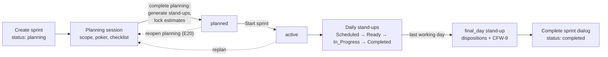

# Sprint and Stand-up Developer Guide

This is the starting point for anyone who will change the sprint lifecycle or the stand-up module. It covers four things:

1. **What the feature is**, and what problem it solves.
2. **How it works**, from sprint creation to sprint close.
3. **Why it is built the way it is.** Most choices look strange until you know the platform constraints behind them.
4. **What is actually built.** Some parts are finished, some are built but not wired up, and some were deliberately left out.

The status claims here were checked against the code on branch `feature/standup-module-implementation` on **2 November 2026**. Where an older document disagrees with this one, this one was checked more recently. See [Which document to trust](#which-document-to-trust).

## Contents

1. [The feature in one page](#1-the-feature-in-one-page)
2. [Which document to trust](#which-document-to-trust)
3. [The four platform facts behind the design](#3-the-four-platform-facts-behind-the-design)
4. [Architecture and the rules every change must keep](#4-architecture-and-the-rules-every-change-must-keep)
5. [The lifecycle, end to end](#5-the-lifecycle-end-to-end)
6. [Sprint management: states, planning, poker, start, complete](#6-sprint-management)
7. [The stand-up: generation, jobs and the daily run](#7-the-stand-up)
8. [Capacity, allocation, variance and estimate debt](#8-capacity-allocation-variance-and-estimate-debt)
9. [Closing a stand-up: checks, overrides, the saga](#9-closing-a-stand-up)
10. [Exceptions: missed, backfill, reopen, calendar changes](#10-exceptions)
11. [Screens and navigation](#11-screens-and-navigation)
12. [Analytics and oversight](#12-analytics-and-oversight)
13. [Permissions](#13-permissions)
14. [Design decisions, with their costs](#14-design-decisions)
15. [Implementation status](#15-implementation-status)
16. [How to extend the module](#16-how-to-extend-the-module)
17. [Running, testing and seeding locally: the traps](#17-running-testing-and-seeding-locally)
18. [Code map](#18-code-map)
19. [Open questions and suggested next work](#19-open-questions-and-suggested-next-work)
20. [Glossary](#20-glossary)

---

## 1. The feature in one page

Most stand-ups are status meetings. The specification asks the Kanvaro stand-up to be a **planning gate** that answers three questions every working day:

- Is each person's day full?
- Did yesterday's plan happen?
- If not, why not?

To do that, the branch builds two connected systems.

**A gated sprint lifecycle.** Sprints get two new states, `draft` and `planned`. A sprint can only start once a planning session passes a server-side checklist. In practice that means every task has one owner and an estimate agreed by planning poker. Completing planning freezes the original estimates and generates one stand-up record per working day.

**A daily stand-up that fills every day and explains every overrun.** Each member's capacity for the day is computed from the working calendar, holidays, leave, ceremonies and attendance. The PM allocates real tasks against that number until the day is full. Yesterday's plan is compared with logged time and classified into one of twelve outcomes. Overruns go into an append-only **estimate debt** ledger. Unfinished work becomes a carry-forward item that ages until somebody resolves it. A stand-up cannot complete until eleven checks pass, or until the PM records a justified override on the checks that allow one.

Two ideas sit under everything:

- **The day must be filled.** A half-planned day is a visible failure, not an empty screen.
- **Estimates are answered, not forgotten.** The gap between estimate and reality must always carry an explanation.

The module is large. Against `main`, the branch touches about 790 files. Most of the domain logic is in `src/lib/standup/` (about 80 modules) and the UI is in `src/components/standup/`.

---

## Which document to trust

Several documents exist in this folder and next to it. They were written at different times and for different readers.

| Document | What it is | How far to trust it |
|---|---|---|
| **This guide** | The starting point: concepts, decisions and verified status | Checked against code on 2 Nov 2026 |
| [`Kanvaro-Standup-Module-Spec-v1.0 (1).md`](./Kanvaro-Standup-Module-Spec-v1.0%20(1).md) | The 2,856-line requirements spec. Code comments cite its IDs (`RUN-23`, `CC-6`, `PC-3`) | Source of truth for *requirements*, not for what was built. It assumes infrastructure Kanvaro does not have (see §3) |
| [`../standup-module.md`](../standup-module.md) | Reference tables: data model, full API list, error catalogue, config fields, jobs, notifications | Accurate on most tables. **Two known errors**, listed below |
| [`Sprint-and-Standup-Implementation-Decisions-1on1.md`](./Sprint-and-Standup-Implementation-Decisions-1on1.md) | A 24 Oct briefing: decision records, spec-vs-build table, Q&A | Accurate as of 24 Oct, except that it says the analytics page does not exist. The page was built on 25 Oct |
| [`standup-module-implementation-history.md`](./standup-module-implementation-history.md) | A phase-by-phase narrative of how the module was built and fixed | Good for the *why*. It was written from plans rather than from the code, so do not rely on it for status |
| [`planning-poker-system.md`](./planning-poker-system.md) | Planning poker in depth: data model, rules, the SSE live-update design | Accurate. Read it before touching poker |

**Errors in `docs/standup-module.md` to be aware of:**

1. It says outstanding debt reduces tomorrow's capacity under the default `absorb` policy. **It is the other way round.** Debt reduces capacity only under `overrunPolicy: 'reduce'`. Under `absorb`, debt is shown as a badge and capacity is unchanged (`src/lib/standup/capacity.ts`, step 6).
2. It describes the planning checklist as `PC-1`…`PC-7`. **The code has `PC-1`…`PC-9`.** `PC-8` and `PC-9` were added beyond the spec (see [§6.3](#63-the-planning-checklist)).

The plan files that the history and the memory notes mention (`docs/superpowers/plans/...` and `docs/superpowers/specs/...`) are **no longer in the repository**. The history document is the surviving summary of them.

---

## 3. The four platform facts behind the design

These are facts about how Kanvaro is deployed, not about its code, so reading `src/` will not reveal them. Most of the places where the build departs from the spec trace back to one of these four.

| # | Fact | Evidence | What it forced |
|---|---|---|---|
| 1 | **No scheduler on the main deployment path.** Kanvaro is self-hosted and Docker-first. | `entrypoint.sh` and the Dockerfiles run no cron. `npm start` is `next start`. `bull` and `socket.io` are in `package.json` but nothing in `src/` imports them. `vercel.json` crons do not run on self-hosted installs. | An in-process ticker started from `src/instrumentation.ts`, with Mongo-based locks. |
| 2 | **MongoDB transactions cannot be assumed.** | `docker-compose.yml` runs standalone `mongo:6.0`. The connection string is entered in the setup wizard and saved in `config.json`, so it could point at a standalone `mongod` or at Atlas. `startSession` and `withTransaction` appear nowhere in `src/`. | Multi-step writes are resumable, idempotent sagas, protected by unique indexes. |
| 3 | **Redis is optional.** | `src/lib/redis.ts` throws when `REDIS_URL` is unset. | Nothing in the module imports Redis. That rules out presence, pub/sub and Redis locks. |
| 4 | **There is no i18n framework.** | There is no `next-intl` and no `i18next`. | Every user-facing string goes in `src/lib/standup/strings.ts`, ready for translation later. |

There is also a fifth difference, and it is a mismatch rather than a constraint. The spec assumes multi-tenant `/organizations/:orgId/...` routes. Kanvaro is single-tenant, with the organisation taken from the session. Routes therefore never carry an org id. An org id in the path would be decorative at best, and at worst it would open an authorisation bypass.

**Rule for future work:** before you design anything that needs a timer, an atomic multi-document write, shared server state or translated text, assume none of those exist. Design the degraded path first.

---

## 4. Architecture and the rules every change must keep

### 4.1 Layers

```
API route (src/app/api/**)           auth, permission, version header, error envelope
   │
service (src/lib/standup/*-service)  loads data, calls the rules, writes, audits
   │
pure rules (src/lib/standup/*.ts)    no database, no clock, no I/O — tested exhaustively
   │
model (src/models/*)                 schema + invariants enforced in hooks
```

Every rule that matters lives in a pure module next to a service that loads data for it:

| Pure rules | Loader / writer |
|---|---|
| `working-day.ts` | `calendar-service.ts` |
| `capacity.ts` | `capacity-context.ts` (the single capacity loader) |
| `allocation.ts` | `allocation-service.ts` (the only writer of `Allocation`) |
| `variance.ts` | `variance-service.ts` |
| `carry-forward.ts` | `carry-forward-service.ts` |
| `planning-checklist.ts` | `planning-service.ts` |
| `sprint-close.ts` | `sprint-close-service.ts` |
| `analytics.ts`, `analytics-payload.ts` | `analytics-service.ts` |

The pairing is there for a specific reason, not for neatness. Because the pure half has no database dependency, **the same function runs in the browser and on the server.** The browser runs it to give a provisional answer (for example, whether the Complete button is enabled). The server runs it again for the authoritative answer, using data it loaded itself.

### 4.2 Cross-cutting rules

These hold across the whole module. Breaking one of them is a defect, not a trade-off.

1. **Integer minutes everywhere.** Every domain function takes and returns `Minutes` (`minutes.ts`). Hours appear only at the display boundary, through `formatMinutesAsHours()`. A service signature with float hours is a bug (`DAT-2`).
2. **No new hard infrastructure dependency.** `docker-compose up` with an existing `.env` must keep working. No new required environment variable and no new service.
3. **No MongoDB transactions.** Use the saga primitive (`saga.ts`) and unique indexes instead.
4. **`resolveWorkingDay()` is the only calendar authority** (`CAL-1`). No other code decides whether a day is a working day.
5. **Permissions are enforced on the server for every route** (`route-helpers.ts`, `permission-middleware.ts`). Hiding a button is never enough.
6. **Every mutation writes an audit entry** through `recordAudit()` (`audit.ts`). Services never call `logActivity` directly.
7. **Ledgers are append-only.** `EstimateDebtLedger` hooks throw on every update and delete method. Corrections are posted as new rows.
8. **`originalEstimateMinutes` cannot change once `estimateLockedAt` is set**, and this is enforced in a Mongoose hook.
9. **No inline user-facing strings.** Every string goes through `standupStrings`.
10. **Every descoped capability announces itself** on screen through a degradation code (`degradation.ts`). Silently doing nothing is a defect.
11. **Read models are derived and can be thrown away.** `MemberSprintDebtSummary` can always be rebuilt from the ledger.
12. **One implementation per action.** Drag-and-drop, keyboard shortcuts and buttons all call the same mutation function. A second write path for the same action is a defect.

---

## 5. The lifecycle, end to end



1. **Configure** (once per project). On the project's Stand-ups tab, set the stand-up time, duration, tolerances and policies. The working calendar and member capacity are on the same tab. Org admins and HR manage holidays in organisation settings.
2. **Plan.** Open a planning session from `/sprints/[id]/planning`. Scope the sprint, run poker, and pass the checklist. Completing planning generates the stand-ups, locks the estimates and moves the sprint to `planned`.
3. **Start.** `POST /api/sprints/[id]/start` refuses anything that is not `planned`.
4. **Every working day.** The scheduler moves each stand-up to `Ready` at its lead time, sends reminders, and marks overdue ones `Missed`. The PM opens the run screen, presses Start, works through the panels and completes the stand-up.
5. **Final day.** Every open task needs a disposition and every open carry-forward item needs a resolution before the stand-up can complete.
6. **Close.** The existing Complete Sprint dialog moves unfinished tasks and marks the sprint `completed`. It does **not** currently look at the stand-up module (see [§15.2](#152-built-but-not-connected)).

---

## 6. Sprint management

### 6.1 Sprint states

`src/lib/standup/sprint-states.ts`

```
draft → planning → planned → active → completed
  └────────┴──────────┴────────┴────→ cancelled
```

| From | Allowed to |
|---|---|
| `draft` | `planning`, `cancelled` |
| `planning` | `planned`, `draft`, `cancelled` |
| `planned` | `active`, `planning` (reopen, spec E20), `cancelled` |
| `active` | `completed`, `planning` (replan), `cancelled` |
| `completed`, `cancelled` | nothing (terminal) |

- The change is **additive.** The four original states (`planning`, `active`, `completed`, `cancelled`) keep their meaning, so no migration was needed. `LEGACY_SPRINT_STATES` exists so a test can prove that.
- New sprints still start in `planning`. `draft` is optional.
- Use the helpers instead of hard-coded lists. `LIVE_SPRINT_STATES` (`draft`, `planning`, `planned`, `active`) replaced scattered `['planning','active']` filters that would have hidden the new states from sprint pickers. `STARTABLE_SPRINT_STATES` is `['planned']` only. `hasStandups()` is true for `planned`, `active` and `completed`.
- New fields on `Sprint`: `activePlanningSession`, `plannedAt`, `planningWaiver`, `calendarAnomalies[]` and `healthWarnings[]`.

**Reopen loop (fixed).** Because `planned → planning` is legal, the planning screen used to show a plain "Start planning" button on a sprint that had already been planned. A PM could loop plan → complete → plan forever. The state machine was correct, and the fix was in the UI only. When the session `history` is non-empty, `PlanningWorkspace.tsx` shows "Reopen planning" with a confirmation dialog that names when the sprint was last planned.

### 6.2 The planning session

`SprintPlanningSession` holds the open session for a sprint. Its routes are under `/api/sprints/[id]/planning-session` (`/assignments`, `/checklist`, `/complete`) and `/api/sprints/[id]/planning-waiver`.

The workspace (`/sprints/[id]/planning`, `PlanningWorkspace.tsx`) has a two-pane backlog/scope layout with `@dnd-kit` drag-and-drop. The drop logic is the pure `resolveDrop()`. Click-based Add and Remove buttons remain as the keyboard path. The workspace also shows a capacity gauge (`GradientProgress`), poker, and the checklist.

`completePlanning()` in `planning-service.ts` runs in this order, and **the order matters**:

1. Evaluate the checklist on the server. Any mandatory failure throws `COMPLETION_CHECKS_FAILED`.
2. Any failing advisory that was not acknowledged also throws (`E19`), so a sprint cannot be planned at 200% of capacity with nothing on record.
3. Assert that `→ planned` is a legal transition.
4. **Generate the stand-ups before freezing anything.** A sprint with no working days throws at this point and is left exactly as it was: session open, sprint still in `planning`.
5. Save the session, with checklist results and a scope snapshot.
6. Stamp `estimateLockedAt` on every task in the sprint. This one write switches on the model-layer immutability guard.
7. Set the sprint to `planned` and record `plannedAt`.

The lock goes on the **task**, not the sprint, so a task moved to another sprint stays frozen.

### 6.3 The planning checklist

`src/lib/standup/planning-checklist.ts`. Mandatory items block completion. Advisory items never block on their own, but they must be acknowledged.

| ID | Kind | Meaning (short) |
|---|---|---|
| PC-1 | mandatory | The sprint goal is at least 10 characters |
| PC-2 | mandatory | The sprint has at least one task |
| PC-3 | mandatory | Every task is estimated. The capacity board means nothing without this |
| PC-4 | mandatory | Every task says what "done" means |
| PC-5 | mandatory | Every task has a type and a priority |
| PC-6 | mandatory | The sprint has a team |
| PC-7 | mandatory | The date range is valid and contains at least one working day. An inverted range and an all-weekend range get different messages (E2) |
| **PC-8** | mandatory | **Added beyond the spec.** Every task is owned by exactly one member of this sprint's team. Variance and debt attach to one owner. Work parked on someone outside the roster silently disappears from every capacity number |
| **PC-9** | mandatory | **Added beyond the spec.** Every estimate came from a poker round. This checks provenance, not agreement. Frozen estimates are exempt, because they cannot be re-pokered and demanding it would deadlock older sprints |
| PA-1 | advisory | Scope is over capacity |
| PA-2 | advisory | Scope is well under capacity |
| PA-3 | advisory | A task is bigger than the largest single day on the team |
| PA-4 | advisory | A task was estimated, or corrected, without a team vote |
| PA-5 | advisory | A member's assigned work is over their own sprint capacity (daily capacity × working days), named per member |
| PA-6 | advisory | A team member has no work assigned at all |

Each item's `checkId` and comment are in the source, and the messages are in `standupStrings.planning`.

### 6.4 Planning poker

Read [`planning-poker-system.md`](./planning-poker-system.md) for the full design. The points that matter most when changing it:

- There are five decks (the default is `fibonacci`). Combining the hours deck with story points is refused.
- Consensus is recorded but never enforced. The facilitator sets the final number. Outliers are measured in deck positions from the median position, not by arithmetic distance.
- **Votes stay on the server until reveal.** Hiding them in the UI alone would still expose them in the network tab.
- Live updates use **SSE that carries a signal only, never data.** The client reacts by calling the same `sync()` it would call on a poll. If the stream drops, the client falls back to 4-second polling, so the stream can never leak a card and is never a second source of truth.
- A finalised estimate is rounded to whole minutes once and written to `Task.originalEstimateMinutes` and `remainingEstimateMinutes`.
- A project's points-to-hours factor changes through `points-migration.ts`, which previews the effect before applying it (`PLN-14`, `E17`).

### 6.5 The planning waiver

An escape hatch for real teams, built so it is always visible.

- Only roles with `standup:planning_waiver` (Super Admin and Admin) can issue one.
- The justification must be **at least 30 characters**, which is longer than an override's 20.
- It expires after 7 days by default, and never later than the sprint end.
- It names the specific checks it waives, and a banner that cannot be dismissed shows it on every planning and stand-up screen.
- **A waiver can never make an unestimated task allocatable** (`PLN-19`). `assertTaskAllocatable()` deliberately takes no waiver argument.

The waiver relaxes the stand-up planning gate (`planning-gate.ts`, `AC-5`). It does not make a `planning` sprint startable, because `STARTABLE_SPRINT_STATES` is `planned` only.

### 6.6 Starting and completing a sprint

- **Start** (`/api/sprints/[id]/start`) needs status `planned`, `SPRINT_START` on the project, and at least one non-archived task. A sprint still in `planning` has no stand-ups and no frozen estimates, so starting it would create an active sprint that could never remind anyone of anything. On the sprint page, the Start button is shown but disabled with the reason until the sprint is planned.
- **Complete** (`/api/sprints/[id]/complete`) is the **pre-existing** endpoint. It moves unfinished tasks to the backlog or to a target sprint and sets the sprint to `completed`. It **does not read the stand-up module**: it ignores `sprintCloseDisposition` and does not require the final stand-up to be completed. This is a known gap, not a decision. See [§19](#19-open-questions-and-suggested-next-work).
- **Sprint GET cleanup** (`/api/sprints/[id]` GET, changed 26 Oct). The handler removes tasks from `sprint.tasks` when they no longer belong to the sprint. It now uses **only the task's `sprint` field** as the signal, never its status. Planning commits tasks without changing their status, and starting a sprint does not change status either, so a freshly planned task is legitimately still `backlog` while the sprint is active. Moving a task back to the backlog clears `task.sprint` in the task PUT handler, and that is the signal to rely on.

---

## 7. The stand-up

### 7.1 What a stand-up record is

One `Standup` per working day per sprint, unique on `{sprint, standupDate}`. Each one has:

- a **shape**: `day_one`, `mid_sprint` or `final_day`, decided by working-day ordinal rather than calendar date;
- a status;
- a facilitator;
- embedded `attendance[]`;
- a `version` for optimistic concurrency;
- `completionState`, the saga checkpoint.

Day numbers are always recomputed rather than stored. `displayedDayNumber` is frozen at completion for audit only. A completed stand-up is immutable, and its capacity is resolved as of its own date (`DAT-1`).

**Stand-up status machine** (`lifecycle.ts`, the only code that writes `status`):

```
Scheduled → Ready → In_Progress → Completed ⇄ Reopened
    │         │
    └─────────┴──→ Missed        (exceptional / terminal)
Skipped_Holiday, Cancelled       (exceptional / terminal)
```

### 7.2 Generation

`generation.ts` creates one stand-up per working day when planning completes. Generation is **idempotent**: running it again creates nothing new. Non-working days become visible `Skipped_Holiday` rows rather than gaps. If a sprint extends past the loaded holiday data, generation raises `HOLIDAY_COVERAGE_GAP` as a warning.

The PM can also regenerate the schedule (reconcile it) from the schedule hub through `POST /api/sprints/[id]/standups/generate`.

### 7.3 Background jobs

`src/lib/standup/jobs/`. Every job is a pure `(now) => Promise<JobResult>` function in a registry. Locking, heartbeats and logging live in the runner.

| Job | Cadence | What it does |
|---|---|---|
| `promote-to-ready` | 5 min | `Scheduled → Ready` at the lead time, builds the snapshot, sends N2 |
| `send-reminders` | 5 min | N1 reminder at the reminder lead time |
| `mark-missed` | hourly | Overdue stand-up `→ Missed` at project-local end of day, rolls obligations forward, escalates via N8 |
| `generation-audit` | daily | Repairs active sprints that are missing stand-ups |
| `escalate-carry-forward` | daily | Re-attaches stranded items and escalates aged ones (N9) |
| `sprint-health` | daily | Projected burn against capacity, N12 |
| `readmodel-refresh` | — | Declared name with **no implementation**. The runner treats it as a skip |

**How they run:**

- **Self-hosted (default).** `src/instrumentation.ts` starts a 60-second in-process ticker. Each run takes a `JobLock` (Mongo, TTL index, 300 s), so two app instances still produce one execution. Every job resolves each project's *local* time itself. There is no global midnight. Each tick writes a `__scheduler__` heartbeat. `SCHEDULER_STALE` fires when that heartbeat is more than 15 minutes old.
- **Serverless.** Set `KANVARO_INTERNAL_SCHEDULER=false` and let the platform call `/api/cron/standup/[job]`. **`vercel.json` lists only four of the six working jobs.** `escalate-carry-forward` and `sprint-health` will not run on Vercel until they are added.
- **`CRON_SECRET`** is enforced if it is set and never required. When set, the `/api/cron/*` routes require a matching `Authorization: Bearer` header (compared in constant time). When unset, `CRON_ROUTES_UNAUTHENTICATED` reports that fact.

Every job runs every minute on self-hosted installs, so **every job must gate itself on time and be safe to run twice.** Logs are structured JSON (`standup.scheduler.started`, `standup.job.run`). Those logs are the whole observability story, because metrics were descoped.

### 7.4 The run screen

`src/components/standup/run/StandupRunScreen.tsx`, at `/projects/[id]/sprints/[sprintId]/standups/[standupId]`.

The run screen has seven panels, worked through in order:

1. **Attendance.** Everyone defaults to present. Unrecorded members show as unset rather than ticked (`RUN-6`).
2. **Yesterday's review** and status reconciliation.
3. **Variance**, and the re-estimate prompts it raises.
4. **Carry-forward register.**
5. **Allocation**: the unassigned pool next to the capacity board.
6. **Blockers.**
7. **Completion gate.**

On `day_one`, Panel 5 moves to the **top** and Panels 2–4 are absent, because there is no yesterday. Day one also shows the sprint assignment progress meter ("18 of 24 tasks assigned, 196h of 268h placed").

Two behaviours carry most of the risk on this screen:

- **Optimistic edits with visible rollback (`RUN-25`).** Values change on screen before the server answers. If the server refuses, the value reverts *and a toast says so*. Reverting silently would be worse than having no optimism at all.
- **The version token lives in a `useRef`, not in state (`RUN-23`).** Every mutating request sends `X-Standup-Version`. A mismatch returns `409 STALE_STANDUP`. When the token was held in state, two quick edits both sent the first edit's version, and the second was refused even though the client had done nothing wrong.

There is **no live update** on the run screen. It loads once and has a manual Refresh button. A second facilitator's edits only surface when you write (and get `STALE_STANDUP`) or press Refresh. The only 1-second interval on the screen drives the clock. Only the poker modal is live.

Keyboard shortcuts (`keyboard-shortcuts.ts`, a pure matcher, including the `g`-then-`s` chord) reuse each row's own action handlers through `data-row-id`. They never add a second mutation path.

### 7.5 The member's view

`/my/standup` (`MyStandupScreen.tsx` and `src/components/standup/my/`).

- It redirects to today's stand-up, using `findOpenStandupCandidates()` in `my-standup-candidates.ts`.
- If the member has more than one stand-up today (they sit on several projects' sprint teams), the others appear in an "also today" banner instead of being silently dropped. A project switcher lets the member move between them.
- Stand-ups whose **project has been deleted are filtered out** (26 Oct). Such a stand-up cannot be opened, because it returns 403, yet an `In_Progress` one would outrank every live stand-up and trap every attendee on a dead end.
- An org admin with no project to land on gets the cross-project **oversight** screen instead (see §12).
- The screen is a thin wrapper over the same `loadAllocationBoard` read and `RunScreenData` shape, filtered to one member. It makes five parallel, read-tolerant fetches: if one section fails, only that section shows its error.
- **Content rules:** every section header carries a live number ("Yesterday — 2 of 3 done, 6.5h logged"). Each state has one computed headline sentence built from the member's own numbers. Every empty state states a fact ("Nothing blocked. Two tasks carried from yesterday").
- **Own-row editing (`RUN-26`, `own-row.ts`).** A member may edit their own row while the stand-up is `Ready` and is locked out once it is `In_Progress`. On `PATCH .../yesterday` the own-row path can change only `status` and `loggedMinutes`. The `note` field stays PM-only.

---

## 8. Capacity, allocation, variance and estimate debt

### 8.1 Capacity

`computeCapacity()` in `capacity.ts`, loaded **only** through `capacity-context.ts`. The capacity board and the completion checks therefore always agree.

```
nominalMinutes            the member's standard day (480 if no MemberCapacity record)
  × partial-day scaling
  − adjustments[]         leave, ceremonies, non-project commitments, member
                          exceptions, optional holidays, partial attendance
  = adjustedMinutes       floored at 0
  − outstandingDebt       ONLY when overrunPolicy === 'reduce'
  = effectiveMinutes      what can be allocated today
  − allocatedMinutes
  = gapMinutes            > 0 means the day is not full
```

- **Adjustments are itemised, never lumped together.** Each `{type, label, minutes}` line can be explained in the member drawer.
- `status` is one of `full`, `under`, `over`, `zero` or `unavailable`.
- `strandedMinutes` reports hours sitting on someone who cannot do them. It is the sum of **two** mechanisms: detached minutes (absent owner), and allocated minutes when capacity is zero. When it was defined by allocated minutes alone, detachment removed those rows and the alert dropped to zero exactly when it should have fired.
- **Ceremonies reduce capacity and never become allocations.** An allocation must point at an estimated task, and a meeting would pollute the pool, the variance engine and the ledger. Only attendees and the facilitator lose the time. Cancelled events deduct nothing.
- `daily_standup` `SprintEvent`s are **excluded** from the ceremony sum, because the stand-up's own duration is already deducted once. Without that exclusion, every day shrinks twice and the numbers still look plausible. There is a regression test named after this.
- `MemberCapacity` rows use `effectiveFrom` and an **exclusive** `effectiveTo`.

### 8.2 Allocation

`allocation-service.ts` is the only code that writes `Allocation`. Every mutation returns the member's fully recomputed `CapacityBreakdown`.

- An allocation is **one member committing minutes to one task on one stand-up.** It is not the same as task assignment: one assigned task can be allocated on four separate days.
- The default amount (`ALO-5`) is `min(remainingEstimate, gap)`, never less than 15 minutes and never zero.
- **Over-allocation is never blocked at write time** (product decision D3). It is caught at completion by CC-6 and needs an override acknowledged by the member.
- A partial unique index on `{standup, member, task}` filtered to `detachedReason: null` lets a reassignment coexist with a detached row.
- `source` records how the row arrived: `pre_assigned`, `assigned_in_standup`, `carried_forward`, `auto_prefilled` or `self_selected`. **`auto_prefilled` is never produced today**, because `planPrefill()` has no caller.
- **Task owner.** `Task.assignedTo` is an array, but variance needs exactly one owner. `resolveStandupOwner()` returns `Task.standupOwner`, or `assignedTo[0]` **at read time**. It is deliberately not a schema default, which would silently pick a winner on every legacy row. Only the owner's allocation carries task-level variance. Other members' allocations are flagged `sharedContribution`.

**Attendance and detachment.** Marking someone absent does not delete their allocations. It *detaches* them (`excludedFromCapacity: true`, `detachedReason: 'owner_absent'`) and offers "Reassign N open tasks?". At completion, detached rows become `owner_absent` carry-forward items and post **no** debt. `partial` attendance is not absence. It carries `partialMinutes`. Leave is entered by the PM only, because there is no leave module and no approval workflow.

### 8.3 Variance

`variance.ts` is a pure classifier, used in two places:

- **provisionally**, in memory, for the board and Panel 3;
- **persistently**, at completion, where `variance-service.ts` writes one `AllocationVariance` per allocation and posts ledger entries.

Both paths share one assembler, so what the PM saw at 09:15 is structurally identical to what the ledger recorded at 09:30.

Each row gets exactly one of twelve outcomes, in this precedence order:

| Rank | Outcome | Why it sits here |
|---|---|---|
| 1 | `descoped` | Beats everything. Needs `task.descopedAt` |
| 2 | `owner_absent` | The person was not there, so no overrun and no credit |
| 3 | `blocked` | A blocker is not an overrun |
| 4 | `no_time_logged_but_progressed` | Warning, no debt |
| 5 | `not_started` | **Ranked above "done"**, so a zero-hour close is never credited as `delivered_under` |
| 6 | `delivered_under` / `_on_estimate` / `_over` | Done; logged time compared with planned time at the tolerance |
| 7 | `reassigned` | A task that was reassigned and then finished is still a delivery |
| 8 | `open_under_consumed` / `_fully_consumed` / `_over_consumed` | Still open. A revision is mandatory when the remaining estimate hits zero |

- Tolerance defaults to 15 minutes in each direction. The boundary tests fail if any `<=` is loosened to `<`.
- Logged time comes only from `time-logs.ts`, computed in project-local time. It **deliberately ignores `isApproved`**, because approval is a billing step and the stand-up must reflect this morning's reality.
- Cancelled task status counts as done and earns a credit. Use `descoped` for scope that was removed.

### 8.4 Estimate debt

`EstimateDebtLedger` is append-only. Its entry types are `accrual`, `credit`, `settlement`, `writeoff` and `carry_in`.

- Two unique indexes make posting idempotent: a sparse unique `{sourceAllocation, entryType}`, and a partial unique `{sourceStandup, member, entryType}` for settlements and carry-ins.
- Outstanding debt is floored at zero for display. A negative balance is **surplus**, shown as "ahead of estimate" and never as negative debt.
- `MemberSprintDebtSummary` is a throwaway read model. `npm run standup:rebuild-debt-summaries` rebuilds it, and a test asserts that a rebuild reproduces the same numbers.
- Debt does not carry between sprints by default (`carryDebtBetweenSprints: false`).
- Individual debt is visible to the member and the PM. Everyone else sees only aggregates. This is checked against the API payload, not only the UI.
- After planning, estimates change only through a **revision** with a reason code (`other` needs at least 10 characters). A revision moves `remainingEstimateMinutes` and never touches the original.

### 8.5 Carry-forward and blockers

**Carry-forward items** (`CarryForwardItem`) are durable obligations that survive the stand-up that raised them and age until resolved. The goal is to make "the same excuse five days running" visible.

- There are nine types (`unfinished_task`, `unrevised_estimate`, `open_blocker`, `owner_absent`, `unassigned_task`, `missed_standup_rollup`, `override_followup`, `not_started_commitment`, `cross_sprint`) and seven statuses.
- The note thread is append-only. A note must be at least 10 characters **and** differ from the previous one, otherwise the API returns `NOTE_UNCHANGED`.
- A note becomes required after `carryForwardNoteThreshold` stand-ups (default 3), and the item escalates after `carryForwardEscalationThreshold` (default 5). An item is "chronic" at age 8 or more.
- `buildCarryForwardSet` deliberately runs on **two clocks**. Board facts come from today's allocations. The `not_started` and open-consumed obligations come from the classifier's one-day lag.
- Nothing writes `cross_sprint` items yet.

**Blockers** (`StandupBlocker`) are their own entity, not carry-forward tags.

- Raising a blocker sets `Allocation.isBlocked`. The service reads `blockedTasksConsumeCapacity` from settings itself rather than trusting a flag from the caller.
- Resolving needs a note of at least 10 characters, and auto-closes the linked `open_blocker` carry-forward item.
- A blocker can be PATCHed only through the stand-up it was raised on.

---

## 9. Closing a stand-up

### 9.1 The eleven completion checks

`completion-checks.ts` is pure. The browser evaluates it to drive the Complete button. `POST /complete` evaluates it again from data the server loaded. **A client payload never decides whether a check passed.**

| Check | Subject | Blocks | Overridable |
|---|---|---|---|
| CC-1 | Every present member's day is filled | yes | yes (`under_allocation`) |
| CC-2 | No duplicate allocation of a task | yes | yes |
| CC-3 | Re-estimates answered | yes | yes (`skip_reestimate`) |
| CC-4 | Carry-forward items have their required notes | yes | **no** |
| CC-5 | Every allocated task is estimated | yes | yes |
| CC-6 | Nobody over-allocated | yes | yes (`over_allocation`, member acknowledges) |
| CC-7 | Attendance recorded | yes | **no** |
| CC-8 | Final day: every open task has a disposition | yes | **no** |
| CC-9 | Blockers reviewed | warns | no |
| CC-10 | Unassigned pool is worked | yes | yes |
| CC-11 | Sprint health: projected burn against capacity | warns | no |

`CFW-9` (on the final day, every open carry-forward item is resolved) is a **separate** gate on the same button rather than a twelfth check. It belongs to a different subsystem with its own vocabulary. A sibling pure function evaluates it, and its failures are merged into the same `blocking` array.

### 9.2 Overrides

There are five override types: `under_allocation`, `over_allocation`, `skip_reestimate`, `duplicate_allocation` and `complete_with_absent_facilitator_role`.

- `validateJustification()` is shared by the client and the server. It requires at least 20 characters and rejects whitespace, punctuation-only text and low-value strings such as "n/a".
- Reason codes are specific to each override type.
- Checks that cannot be overridden render **no control at all**. If the API is called anyway, it returns `OVERRIDE_NOT_PERMITTED`.
- `skip_reestimate` is single-use per task. It creates an `override_followup` carry-forward item and refuses a second consecutive deferral.
- **Chronic under-allocation:** a member's third consecutive under-allocation override fires N7.
- The run screen loads overrides **already on record** together with the checks. Without that, a page reload re-blocked checks that the saga would have passed.

### 9.3 The completion saga

This replaces the spec's single transaction. `runSaga(steps, ctx, checkpoint)` runs ordered steps keyed by `completionRunId` and records the last completed step in `Standup.completionState`. The steps persist variance, post ledger entries, build the carry-forward set, write the `StandupSummary` and send notifications.

- A re-run **resumes** from the checkpoint rather than starting again.
- A crash between a step's write and its checkpoint re-runs that step. **Every step must therefore be idempotent on its own**, and that is why the unique indexes exist.
- A double submit returns `STANDUP_ALREADY_COMPLETED`. An interrupted run shows `COMPLETION_INTERRUPTED` with a working Resume action.
- The failure-injection test was written before the happy-path test.

### 9.4 Final day

The final-day stand-up adds the sprint-close readiness panel (`sprint-close.ts` and `sprint-close-service.ts`).

- Each open task needs a `Task.sprintCloseDisposition`: `finish_today`, `descope`, `move_to_next_sprint` or `split_and_move_remainder`. Unlike `standupOwner`, there is no fallback, because "not yet decided" is exactly the state that has to block.
- The projected outcome is recomputed on every read and never stored.
- Owner names go through `resolveStandupOwner()`.
- `hoursAvailableTodayMinutes` is one sprint-wide figure applied to every task. This is an open design question (see §19).

---

## 10. Exceptions

- **Missed.** `mark-missed` handles stand-ups that are still `Scheduled` or `Ready` at project-local end of day. N8 fires on the second and third consecutive misses. Note that the `consecutive_misses` oversight flag looks at the trailing run across *all* stand-ups, so future `Scheduled` days break the run and it never fires in the middle of a sprint.
- **Backfill** (`backfill-service.ts`, `SCH-14`) rebuilds a missed day within `backfillWindowWorkingDays` (default 2) and runs the full saga. Because backfill must not fabricate consent:
  - `skip_reestimate` **cannot** be attested. The re-estimates have to be answered.
  - `over_allocation` can be attested only with the facilitator's explicit confirmation that the members agreed (`memberAcknowledged`). The call is refused before anything is written otherwise. The audit entry records `memberAgreementAttestedFor`.
  - `revision-service.ts` deliberately includes `Missed` in `MUTABLE_STATUSES`. Without that, every missed stand-up with an overrun could never be backfilled.
- **Reopen** works within `reopenWindowHours` (default 24) and returns `REOPEN_WINDOW_EXPIRED` after that. The service computes `affectedDownstreamStandupIds`, **but the route does nothing with them** (see §15.2).
- **Calendar changes.** `reconcile-rules.ts` plans and `reconcile.ts` executes. There are nine triggers (sprint start or end moved earlier or later, a date becoming working or non-working, stand-up time changed, project timezone changed, sprint cancelled). They were proven against all eight stand-up statuses as a table. A change that would destroy a completed stand-up throws and writes nothing. Exactly one N10 notification goes out per change.
- **Holidays are revoked, never deleted.** Deleting one would silently rewrite the capacity of completed stand-ups. Revoking or editing under a `Completed`, `Missed` or `Reopened` stand-up returns `IMMUTABLE_COMPLETED_STANDUP`. Coverage is computed as `max(date)` over active holidays at read time and never stored. An admin-triggered Sri Lanka public-holiday API sync exists, and it never revives a revoked holiday.

---

## 11. Screens and navigation

| Route | Screen | Main components |
|---|---|---|
| `/sprints/[id]` | Sprint detail; the Plan, Start and Stand-ups buttons depend on state | `src/app/sprints/[id]/page.tsx` |
| `/sprints/[id]/planning` | Planning workspace: scope, poker, checklist, waiver | `PlanningWorkspace.tsx`, `standup/planning/`, `standup/poker/` |
| `/projects/[id]/standups` | Schedule hub: sprint health, today's hero row, timeline, regenerate. **Has a project selector** (26 Oct) | `standup/schedule/` |
| `/projects/[id]/sprints/[sprintId]/standups/[standupId]` | The run screen | `standup/run/` |
| `…/[standupId]/summary` | Completed stand-up summary, markdown export, print stylesheet | `standup/summary/` |
| `/my/standup`, `/my/standup/[standupId]` | Member view, or admin oversight | `standup/my/`, `StandupOversightScreen.tsx` |
| `/sprints/analytics` | Sprint picker for analytics. Lists sprints that have stand-ups, **with a project filter** | `src/app/sprints/analytics/page.tsx` |
| `/sprints/[id]/analytics` | Stand-up analytics report | `src/components/sprints/analytics/` |
| Project → Stand-ups tab | Settings, working calendar, capacity and members | `StandupConfigSettings.tsx` and siblings |
| Org settings → Holidays | Holiday sets, import, revocation | |

**Sidebar.** Sprint Management has **Standups** (`/my/standup`) and **Analytics** (`/sprints/analytics`). Neither has a permission gate in the sidebar, on purpose. `standup:view` and `standup:view_analytics` are mostly granted *per project*, so an org-wide check would hide the items from ordinary team members. The pages enforce access themselves.

**Design system.** The screens use the Apple HIG tokens in `globals.css` (`--apple-*`, `.apple-type-*`). Some stand-up surfaces still use a hard-coded Figma palette and Inter. Moving them onto the tokens is wanted. Primitives that every new screen should reuse: `Drawer`, `ModalOverlay`, `CapacityMeter`, `HourStepper`, `QuickAddCombobox`, `GradientProgress`.

---

## 12. Analytics and oversight

### 12.1 Stand-up analytics (built 25 October)

The analytics page (spec §15.15) is part of **Sprint Management**, not the stand-up routes. The spec put it at `/projects/[id]/sprints/[sprintId]/analytics/standups`. The build uses `/sprints/[id]/analytics`, with `GET /api/sprints/[id]/analytics`.

| Layer | File |
|---|---|
| Pure aggregation | `src/lib/standup/analytics.ts`: `computeDayHealth`, `computeDebtTrend`, `debtChange`, `computeAccuracy`, `ageHistogram`, `chronicUnderAllocation`, `computeDiscipline`, `spillChains` |
| Payload shaping | `analytics-payload.ts`: `buildAnalyticsPayload(inputs, view)` |
| Loader | `analytics-service.ts`: `loadAnalyticsInputs`, `getSprintAnalytics` |
| Widgets | `AnalyticsHero`, `AnalyticsStatGrid`, `AllocationHealthCard`, `DebtTrendCard`, `AccuracyCard`, `AgeingCard`, `ChronicUnderAllocationCard`, `DisciplineCard`, `OverrideLogCard`, `SpillChainsCard`, `RowsTable` |

Design decisions:

- **Two views, chosen by permission, never by role name.** The route requires `standup:view_analytics`. Callers who also hold `standup:view_debt` (Admin, PM) get the `full` view, with individual accuracy, debt, override justifications and names. Everyone else gets `aggregate`, with team totals only.
- **The aggregate payload is built from scratch, never copied from the full one and then pruned.** A field added to the full view later cannot leak into the aggregate view by default.
- **No rule is re-derived.** Debt goes through `computeDebtPosition`, accuracy through `estimationAccuracy`, chronic carry-forward through `CHRONIC_AGE_THRESHOLD`, and chronic under-allocation through the same three-override rule the oversight rollup uses. The analytics page therefore cannot disagree with the run screen or the oversight screen.
- **Allocation health is computed per member, not from day totals.** One member 60 minutes over and another 60 under would net to "full" in aggregate, and that imbalance is exactly what the widget exists to show.
- `analytics.ts` and `analytics-payload.ts` import **no Mongoose**, because the page imports their types into the browser bundle.

Known data gaps: the carry-forward ageing chart is nearly empty for a normally closed sprint, because the final-day gate forces every item closed. The chronic flags need three overrides, or an age of 8 or more, before anything shows.

### 12.2 Admin oversight

`GET /api/organization/standup-oversight` and `admin-oversight.ts` power `StandupOversightScreen`. It is reached from `/my/standup` when an org admin has no project of their own to land on. It answers "where do I need to intervene today?" across all projects, using flags such as `over_capacity`, `open_blockers`, `chronic_under_allocation`, `consecutive_misses` and `chronic_carry_forward`. Its sprint cards link to the sprint's analytics page.

Access is checked by **role** (Admin or Super Admin), not by permission, because PMs also hold `standup:view_analytics` org-wide.

---

## 13. Permissions

There are 18 `standup:*` permissions plus the organisation-scoped `holiday:manage`:

`configure`, `view`, `generate`, `run`, `run_own`, `complete`, `reopen`, `allocate`, `allocate_own`, `override`, `revise_estimate`, `carry_forward_note`, `blocker_raise`, `view_debt`, `view_own_debt`, `write_off_debt`, `view_analytics`, `planning_waiver`.

| Role | Stand-up permissions |
|---|---|
| Super Admin | all |
| Admin | all, plus `holiday:manage` |
| Human Resource | `view`, plus `holiday:manage` |
| Project Manager (org and project) | all except `holiday:manage` and `planning_waiver` |
| Project Member / QA Lead / Tester | `view`, `allocate_own`, `run_own`, `blocker_raise`, `view_own_debt`, `view_analytics` |
| Viewer / Project Viewer | `view`, `view_analytics` |
| Team Member (**org** role) | **none, by design** |
| Client / Project Client | none |

Three design points to keep:

- **The org Team Member role holds nothing.** A grant in the org table applies org-wide: `hasPermission` returns true for a project-scoped permission as soon as the org role holds it. Giving the org role `standup:view` would let every team member read every project's capacity gaps and debt. A member of a project resolves to `PROJECT_MEMBER`, which carries the same capability scoped to that project.
- **Two-tier own-row permissions.** The route wrapper checks the narrow permission (`allocate_own`, `run_own`). The handler then checks the broad one (`allocate`, `run`) to decide whether the caller may touch *someone else's* row.
- **Roles are seeded and cannot be repaired from Settings**, so a missing permission is a defect shipped to every install. `src/lib/permissions/__tests__/standup-role-matrix.test.ts` derives "can this role be given work?" from task permissions, so a role added later is caught automatically.

---

## 14. Design decisions

Each record covers what was decided, why, and what it costs. The 24 Oct decisions brief has longer versions of most of them.

| # | Decision | Why | Cost |
|---|---|---|---|
| D1 | **Integer minutes everywhere** | Capacity, 15-minute steps, tolerances and ledger sums are all comparisons. Float hours make "is this exactly full?" unreliable | A conversion at every boundary |
| D2 | **Pure rules plus a loader service** | Exhaustive tests without mocks. The same function runs provisionally in the browser and authoritatively on the server. A single capacity loader means the board and the checks cannot disagree | Two files per concept, and the discipline to keep I/O out of the pure half |
| D3 | **In-process ticker plus Mongo `JobLock`**, with HTTP cron routes for serverless | Works on a stock `docker-compose up` and on Vercel. Redis is optional, so a Redis lock would make the scheduler optional too | It dies with the process (mitigated by `SCHEDULER_STALE`). Every job runs every minute and must gate itself. Two jobs are missing from `vercel.json` |
| D4 | **Resumable saga instead of a transaction** | Transactions fail outright on standalone `mongod` | Every step must be idempotent, which is why the unique indexes exist. It has not been crash-tested against a live database |
| D5 | **Optimistic concurrency (`version` and `409`) instead of presence** | Presence needs shared server state | No live updates on the run screen. The planned polling was not built |
| D6 | **Append-only debt ledger plus a rebuildable summary** | A record you can rewrite cannot be audited | More rows, plus a rebuild command |
| D7 | **Spec product decisions:** `absorb` is the default policy; individual debt is private (member and PM); over-allocation is overridden, never blocked; no debt carried between sprints; suggestions are proposed, never applied; the 15-minute timer is advisory | Least-surprise defaults. A PM must be able to say "yes, knowingly" | Under `absorb`, debt does not shrink capacity, which surprises people who read the older guide |
| D8 | **Planning gate with nine mandatory and six advisory checks**, plus a visible, time-limited waiver | Real teams need an escape hatch, but nobody can later say they were not told | A waiver can never make an unestimated task allocatable |
| D9 | **Lock estimates on the task, generate stand-ups before freezing** | A moved task stays frozen. A sprint with no working days is refused cleanly | — |
| D10 | **Additive sprint states** (`draft`, `planned`) | No migration. Legacy rows stay valid | Every hard-coded status list had to move to the helpers |
| D11 | **`standupOwner` resolved at read time** | `assignedTo` is an unordered array. A schema default would pick a winner on legacy rows | Shared tasks need the `sharedContribution` flag |
| D12 | **Twelve variance outcomes with a written precedence** | The spec's conditions overlap, and each row needs exactly one outcome | The precedence order is a contract. Changing it changes debt |
| D13 | **Ceremonies deduct capacity and never allocate** | No variance outcome makes sense for a meeting | The `daily_standup` exclusion must be maintained |
| D14 | **Detach, don't delete, on absence**, with `detachedReason` separate from `excludedFromCapacity` | Blocked work and absent-owner work carry forward differently | `strandedMinutes` needs two inputs |
| D15 | **Revoke holidays, derive coverage** | `resolveWorkingDay()` is dated, so deleting a holiday rewrites history | — |
| D16 | **Server-authoritative checks; hard blocks render no control** | Never trust the client | Each check is evaluated twice |
| D17 | **Signal-only SSE for poker, with a polling fallback** | The stream cannot leak a card, and there is no second source of truth | — |
| D18 | **Strings centralised, not translated** | Full i18n is a platform project | — |
| D19 | **Analytics in Sprint Management, view split by `view_debt`, aggregate built from scratch** | The PM's report belongs with the sprint, and privacy should be safe by default | Not linked from the sprint page (too crowded). It is reached from the sidebar picker and the oversight cards |
| D20 | **Routes are placed by whether the resource has its own id** | Test: if you removed the parent id from the path, could the server still find the record? If yes, the route goes at the top level (`/api/standups/[id]/...`). Project singletons nest under `projects/[id]/` | — |
| D21 | **Every descope announces itself** (`degradation.ts`) | A missing feature must never look like a working one | Several codes were declared and never fired until a post-launch audit caught them |

**The lesson of the whole build:** most defects were *correct logic that was not connected*. Examples were a guard with no caller, a prop nobody supplied, and data that was fetched and then thrown away. Before claiming something is done, find its production callers and click the control in a running app.

---

## 15. Implementation status

Checked against the code on 2 Nov 2026.

### 15.1 Built and working

- Sprint states, the planning session, the PC/PA checklist, poker with live SSE, the waiver, estimate locking, and the start gate.
- Generation, the eight-state lifecycle, all six working jobs (self-hosted), and the `SCHEDULER_STALE` and `CRON_SECRET` handling.
- The capacity engine, allocation, attendance and detachment, the variance classifier, the debt ledger, carry-forward, and blockers.
- The eleven checks plus CFW-9, overrides, the completion saga, the summary, and markdown export.
- Missed, backfill, reopen (without downstream recalculation), reconcile, and holiday revocation and coverage.
- The schedule hub, the run screen, the summary, My Stand-up, admin oversight, **stand-up analytics** with its picker and sidebar entry, and project selection on the schedule hub and the analytics picker.
- Notifications N1–N13 (N3 is off by default).

### 15.2 Built but not connected

These are the items most likely to surprise a user. Each was confirmed by searching for readers and callers in `src/`.

| Item | State |
|---|---|
| `ProjectStandupSettings.enabled` | Saved in the UI and **never read by server code.** Every sprint that completes planning gets stand-ups, whatever the switch says |
| `requireOverAllocationAck`, `crossSprintCarryForward`, `allowMemberPreEdit` | Saved and not read. Member pre-edit is always allowed while `Ready` |
| Auto pre-fill (`planPrefill()`, ALO-10) | Implemented and tested, with **no production caller** |
| Reopen downstream recalculation | `affectedDownstreamStandupIds` is computed, and the route ignores it |
| Final-day dispositions | Recorded on tasks. `POST /api/sprints/[id]/complete` does not read them |
| Sprint completion gate | A sprint can be completed while its final stand-up is still open |
| `CAPACITY_EXCEEDED` | In the error catalogue but never thrown |
| `LIVE_UPDATES_DEGRADED` | Declared but never shown |
| `readmodel-refresh` | A job name with no implementation |
| `escalate-carry-forward`, `sprint-health` on Vercel | Missing from `vercel.json` |
| `cross_sprint` carry-forward | The type exists, and nothing writes it |

### 15.3 Deliberately descoped for release one

| Descoped | Replaced by | On-screen notice |
|---|---|---|
| Single transaction at completion (NFR-6) | Resumable saga | `COMPLETION_INTERRUPTED` |
| Full i18n | `strings.ts` | — |
| Metrics and alerting | Structured job logs | `SCHEDULER_STALE` |
| Presence avatars (RUN-24) | Optimistic concurrency, manual Refresh | (declared, not shown) |
| Denormalised `standupBoardView` | Live indexed aggregates | — |
| Millisecond performance budgets | No N+1 queries, indexes, pool pagination at 50, virtualisation past 25 members | — |
| Leave module | Leave entered by the PM | `LEAVE_DATA_MANUAL` |
| Suggest-fill allocation | Manual allocation | — |
| Cross-project capacity | Single-project capacity | `CROSS_PROJECT_LOAD_UNAVAILABLE` |
| No time logging on a project | PM-entered `standup_manual` entries | `TIME_LOGGING_MANUAL` |
| Holiday data past the loaded years | Coverage warning | `HOLIDAY_COVERAGE_GAP` |

### 15.4 Not built

- The **task quick-edit drawer** (§15.10). There is no stand-up-specific drawer on task click.
- The **E6 timezone-change confirmation** dialog. The recompute is correct, but nothing makes the PM confirm it.
- A **consolidated accessibility and responsive sweep** across every screen (light and dark, four breakpoints, keyboard only). It was done piecemeal. There are no visual-regression tests.

---

## 16. How to extend the module

The module has a pattern for almost everything. Follow it rather than inventing a new one.

**Adding a completion check.** Add the result to `completion-checks.ts` (pure, in spec order), with its hard and overridable flags. If it can be overridden, add the override type and reason codes in `override.ts`. If it needs new data, load that data in `completion-context.ts` so the browser and the server see the same inputs. Add strings to `strings.ts`. Test the pure function, then add a route-level test that a tampered client cannot pass it.

**Adding a background job.** Write a pure `(now) => Promise<JobResult>` in `src/lib/standup/jobs/`. Register it, gate it on project-local time, and make it idempotent, because it will run every minute. **Add it to `vercel.json` as well**, or it will not run on serverless.

**Adding a mutation route.** Use the helpers in `route-helpers.ts` (permission wrapper, org isolation, error envelope). Require and check `X-Standup-Version` and increment `version`. Call `recordAudit()`. Throw `StandupError` with a code from the catalogue (`errors.ts`), and never invent a code at the call site, because the UI switches on these codes. Put the route by whether the resource has its own id (D20).

**Adding a setting.** Add it to the model, the PUT allow-list in `/api/projects/[id]/standup-settings`, and `StandupConfigSettings.tsx`. **Then add the server code that reads it, and a test that proves the setting changes behaviour.** Four existing settings show what happens when that step is skipped.

**Adding a notification.** Route it through the existing notification service with a `variantKey` so retries do not send twice. Add a per-project switch in `notificationSwitches`.

**Adding a descope.** Add a degradation code to `degradation.ts`, make `getActiveDegradations()` return it, and render it.

**Changing analytics.** Put the arithmetic in `analytics.ts`, keep it free of Mongoose, and reuse the existing rule functions. If a field is individual, add it to the **full** payload only and confirm that the aggregate builder does not reference it.

**Changing capacity or variance.** Run the worked-example test first (`fixtures/worked-example.ts`). It reproduces the spec's §12.3 numbers end to end and fails first when the engine drifts.

---

## 17. Running, testing and seeding locally

### 17.1 Commands

```bash
npm run dev
npm test
npm run type-check
npm run lint
npx jest src/lib/standup src/components/standup src/components/sprints src/app/sprints src/app/my src/lib/permissions
npm run seed:holidays                      # idempotent on set + date + name
npm run standup:rebuild-debt-summaries     # always safe
node scripts/seed-standup-full-demo.js     # demo dataset, raw Mongo driver, idempotent
```

On 2 Nov 2026 that `npx jest` run covered **212 suites and 3,052 tests**, and they all pass. In the parallel run, 2,860 passed, 5 were skipped, and 187 failed. The 187 failures were all in 15 database integration suites (`*.integration.test.ts`, `complete-route`, `task-edit-estimate-sync`). Each failure was a 30-second hook timeout or `Connection operation buffering timed out`. Run serially with `npx jest -i`, **all 15 suites passed (284 tests)**.

Every integration suite shares one in-memory `mongod`, which `jest.global-setup.js` starts. Workers keep their data apart by database name only, so on a loaded machine the parallel workers starve that server. If an integration suite times out, re-run it with `-i` before you treat the failure as a regression.

Testing conventions:

- Pure rules get unit tests. Services get integration tests against a real MongoDB (`__tests__/helpers/mongo.ts`).
- Component tests opt into `jsdom` per file.
- The reconciler is table-driven.
- Boundary tests are deliberately brittle.
- Defects get regression tests named after them.
- Permissions are tested against the API payload, not the UI.

There were pre-existing failing suites on `main` before this branch (22 at Phase 0). Check a failure against `main` before treating it as a stand-up regression.

### 17.2 Traps when testing against a live local database

These cost real time to discover:

- **The scheduler is live in `npm run dev`.** A stand-up dated in the past is marked `Missed` within a minute. To seed past days, hold the lock: insert a `joblocks` document `standup-job:mark-missed` with `expiresAt` far in the future, and delete it when you are done. To get a stand-up to `Ready` with a snapshot, push `scheduledStartAt` far into the future right after generation, then pull one day to now + 10 minutes so `promote-to-ready` builds it.
- **SMTP may point at real inboxes.** Creating a sprint with invitees, assigning tasks and `PUT /api/tasks/:id` all send email. For bulk data, insert tasks and change statuses in Mongo directly.
- **The time API caps entries at 12 hours per member per day**, across all projects. Insert `timeentries` directly if the cap gets in the way.
- **`MemberCapacity.effectiveTo` is exclusive**, and the planning checklist reads capacity as of *today*. Back-date `effectiveFrom` if a sprint starts in the past.
- **"Yesterday" means the last `Completed`, `Reopened` or `In_Progress` stand-up by day number.** If you backfill a missed day before the next live one, that day's variance is empty. Backfill afterwards.
- **A failed backfill leaves its CC-1 override and attendance behind** on the `Missed` day.
- **Carry-forward notes need `standup:carry_forward_note`.** PMs have it and team members do not.
- **Spill chains need `carryChainRoot` and `carriedFromAllocation`** on allocations. Since 10 Nov 2026 `createAllocation` links a re-allocation to the task's most recent allocation on an earlier stand-up in the same sprint, so allocations made through the run screen chain. Rows seeded straight into Mongo still need both fields set by hand.
- **A resolved carry-forward item cannot take a note** (since 10 Nov 2026), and it no longer counts towards CC-4.
- **`descoped` variance needs `task.descopedAt`.** Cancelled status counts as done.
- **When re-mapping timestamps for demo data,** compute the anchors once. Never re-derive them from fields you have already overwritten.
- **Do not write scripts that emulate the environment.** Generate test data in the local database through the real APIs where you can, and fall back to Mongo only for the cases above.
- **`Project.teamMembers`/`projectRoles` and `User.projectRoles` must agree.** Different code paths read each side.

---

## 18. Code map

Everything is under `src/lib/standup/` (domain), `src/components/standup/` and `src/components/sprints/analytics/` (UI), and `src/models/` (schemas).

| Area | Modules |
|---|---|
| Platform spine | `minutes`, `saga`, `errors`, `audit`, `degradation`, `strings`, `route-helpers`, `version-header`, `timezone`, `jobs/*` |
| Calendar | `working-day`, `calendar-service`, `calendar-dates`, `calendar-impact`, `preview-impact`, `holiday-admin`, `holiday-import`, `holiday-api-sync`, `organization-calendar` |
| Capacity | `capacity`, `capacity-context`, `ceremonies` |
| Sprint and planning | `sprint-states`, `planning-gate`, `planning-checklist`, `planning-service`, `poker`, `estimates`, `points-migration`, `assignment-service` |
| Schedule and lifecycle | `generation`, `day-numbering`, `lifecycle`, `reconcile-rules`, `reconcile`, `schedule`, `snapshot`, `start-service`, `reopen-service`, `backfill-service` |
| The meeting | `allocation`, `allocation-service`, `prefill`, `attendance-service`, `yesterday`, `yesterday-service`, `own-row`, `keyboard-shortcuts`, `task-ownership` |
| Variance and debt | `variance`, `variance-service`, `revision-service`, `debt`, `debt-position`, `debt-service`, `debt-summary`, `time-logs` |
| Carry-forward and blockers | `carry-forward`, `carry-forward-service`, `blocker`, `blocker-service` |
| Completion | `completion-checks`, `completion-context`, `completion-saga`, `check-extras`, `override`, `override-service`, `sprint-close`, `sprint-close-service`, `sprint-health`, `summary`, `summary-service`, `notifications` |
| Member and org views | `my-standup-candidates`, `admin-oversight` |
| Analytics | `analytics`, `analytics-payload`, `analytics-service` |

**New models:** `Standup`, `Allocation`, `AllocationVariance`, `EstimateDebtLedger`, `MemberSprintDebtSummary`, `CarryForwardItem`, `StandupBlocker`, `StandupOverride`, `StandupSummary`, `ProjectStandupSettings`, `MemberCapacity`, `WorkingCalendar`, `HolidaySet`, `Holiday`, `PokerSession` (and `PokerVote`), `SprintPlanningSession`, `JobLock`, `JobHeartbeat`.

**Modified models:** `Sprint` (states, planning, waiver, anomalies, health warnings), `Task` (`standupOwner`, `sprintCloseDisposition`, estimate fields, `estimateLockedAt`, `descopedAt`), `TimeEntry`, `Notification`, `Project`, `Organization`, `User`, `ActivityLog`.

`debt-position.ts` deliberately does not import the capacity module, which keeps the dependency graph acyclic against `capacity-context.ts`.

For the full API route list, error catalogue, configuration table with ranges, and notification list, see [`../standup-module.md`](../standup-module.md) (keeping in mind the two corrections in [Which document to trust](#which-document-to-trust)).

---

## 19. Open questions and suggested next work

In rough priority order:

1. **Should sprint completion consult the stand-up module?** That would mean requiring the final stand-up to be completed and applying the recorded dispositions in `POST /api/sprints/[id]/complete`. Doing it changes existing behaviour for every project, so it needs a product decision first.
2. **Wire up or hide the dead settings**, `enabled` first. The settings screen promises behaviour that does not exist.
3. **Call `planPrefill()`.** It is built and tested, and it only needs a caller (probably generation or `promote-to-ready` for day one and carry-forward).
4. **Reopen recalculation.** Act on `affectedDownstreamStandupIds`.
5. **Add the two missing jobs to `vercel.json`**, if serverless is a supported target.
6. **Run-screen freshness.** Add polling, or a signal-only SSE like poker's, and then show or remove `LIVE_UPDATES_DEGRADED`.
7. **Sprint-close `hoursAvailableTodayMinutes`.** Decide whether it should be per owner.
8. **Move the remaining Figma-palette stand-up surfaces onto Apple tokens.**
9. **Add a lint or CI check for exported domain functions with no non-test caller.** That is the defect class this branch hit most.

---

## 20. Glossary

| Term | Meaning |
|---|---|
| **Stand-up** | One record per working day of a sprint |
| **Shape** | `day_one`, `mid_sprint` or `final_day`. Controls which panels and checks apply |
| **Allocation** | One member's committed minutes on one task on one stand-up |
| **Capacity** | Minutes a member actually has on a date, after the calendar, ceremonies, leave, attendance and (under `reduce`) debt |
| **Gap** | Effective capacity minus allocated minutes. Positive means the day is not full |
| **Stranded minutes** | Hours sitting on someone who cannot do them (detached, or zero capacity) |
| **Variance** | Planned against logged minutes for one allocation, classified into one of twelve outcomes |
| **Estimate debt** | The append-only ledger of overruns, credits, settlements, write-offs and carry-ins |
| **Surplus** | A negative debt balance, shown as "ahead of estimate" |
| **Carry-forward item** | A durable obligation that ages until it is resolved |
| **Detachment** | Taking an absent member's allocations out of capacity and returning them for reassignment, without deleting them |
| **Disposition** | The final-day decision for an open task: finish today, descope, move, or split and move the remainder |
| **Override** | A PM knowingly accepting a failing check, with a reason code and a justification of at least 20 characters |
| **Waiver** | An admin's time-limited, visible relaxation of named planning checks (justification of at least 30 characters) |
| **Saga** | Ordered, idempotent steps with a saved checkpoint, used instead of a transaction |
| **Degradation** | A deliberately missing capability that announces itself on screen |
| **Spec IDs** | `SCH` schedule, `RUN` run screen, `ALO` allocation, `CAL` calendar, `PLN`/`PC`/`PA` planning, `VAR` variance, `CFW` carry-forward, `CC` completion checks, `OVR` overrides, `N` notifications, `DAT` data invariants, `SEC`/`NFR` non-functional, `AC` acceptance criteria, `E` edge cases |
